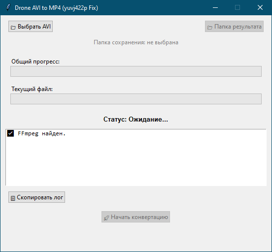

# 🚁 AVI to MP4 Converter

Легковесное десктопное приложение с графическим интерфейсом для пакетной конвертации AVI-видео с дронов в формат MP4,
полностью совместимый с мобильными телефонами.

---

## 📊 Описание и принцип работы

Видеофайлы с некоторых дронов записываются в формате AVI с цветовым пространством `yuvj422p` и несжатым аудио
`pcm_s16le`. Из-за этого видео часто **не открывается на смартфонах** (Android/iOS) или в браузерных плеерах, выдавая
ошибку кодека или черный экран.

**Алгоритм работы:**

1. **Выбор файлов:** Пользователь выбирает один или несколько AVI-файлов через удобный графический интерфейс.
2. **Подготовка:** Приложение автоматически создает папку `convertedVideoDrone` и очищает её от старых файлов с такими
   же именами во избежание конфликтов.
3. **Конвертация:** Запускается процесс FFmpeg в отдельном потоке (`threading`), чтобы не блокировать интерфейс и
   обновлять прогресс-бары в реальном времени.
4. **Оптимизация:** Видео принудительно перекодируется в стандартный `yuv420p` (H.264 Baseline) с удалением проблемной
   аудиодорожки, гарантируя 100% совместимость.

---

## ✨ Ключевые особенности

- 🖥️ **Удобный GUI:** Интуитивный интерфейс на `tkinter`, не требующий знания командной строки.
- 📦 **Пакетная обработка:** Возможность выбрать и конвертировать сразу несколько файлов.
- 📊 **Двойной прогресс-бар:** Отслеживание общего прогресса и прогресса текущего файла в реальном времени.
- 🧹 **Автоочистка:** Автоматическое удаление старых файлов перед конвертацией.
- 📋 **Логирование:** Подробный лог процесса с возможностью копирования в буфер обмена одной кнопкой.
- 🚫 **Zero Dependencies:** Не требует установки сторонних Python-библиотек (используется только стандартная библиотека).

---

## 🛠️ Требования

| Компонент        | Описание                                                                                        |
|:-----------------|:------------------------------------------------------------------------------------------------|
| **Язык**         | Python 3.8 или выше                                                                             |
| **Зависимости**  | Отсутствуют (используются только встроенные модули: `tkinter`, `subprocess`, `threading`, `re`) |
| **Системное ПО** | **FFmpeg** и **ffprobe**, установленные в системе и добавленные в переменную окружения `PATH`   |

> 💡 *При первом запуске приложение автоматически проверит наличие FFmpeg. Если его нет, вы увидите предупреждение.*  
> **Как быстро установить FFmpeg:**
> - **Windows:** `winget install Gyan.FFmpeg`
> - **macOS:** `brew install ffmpeg`
> - **Linux:** `sudo apt install ffmpeg`

---

## 💻 Программное обеспечение

### Скрипт конвертации (Python)

- **Версия:** Python 3.8+
- **Модули:** `os`, `sys`, `subprocess`, `threading`, `re`, `tkinter`

### 🚀 Инструкция по запуску

1. **Клонирование:** Клонируйте репозиторий и перейдите в папку проекта:
   `git clone https://github.com/Pasha33Pro/avi_to_mp4.git`
   `cd avi_to_mp4`
2. **Запуск:** Запустите приложение (установка зависимостей через pip не требуется):
   `python convert_avi_to_mp4.py`
3. **Использование:**
    * Нажмите кнопку **"📁 Выбрать AVI"** и укажите нужные видеофайлы.
    * Приложение автоматически создаст папку `convertedVideoDrone` рядом с исходными файлами.
    * Нажмите **"🚀 Начать конвертацию"** и следите за прогрессом в окне приложения.
    * По завершении нажмите **"📂 Папка результата"**, чтобы открыть готовые MP4 файлы.

---

**Технические флаги FFmpeg:**  
🔴 `-pix_fmt yuv420p` + `-vf format=yuv420p`: Главная фиксация цветового пространства.  
🟠 `-profile:v baseline -level 3.0`: Обеспечивает декодирование на мобильных процессорах.  
🟡 `-an`: Полное удаление аудиодорожки `pcm_s16le` (частая причина сбоев).  
🟢 `-movflags +faststart`: Оптимизация метаданных для быстрого старта воспроизведения.  
🟣 `-vf scale=640:480,fps=30`: Стандартизация разрешения и частоты кадров.

---

## 📄 Лицензия

Этот проект является учебным и распространяется под лицензией MIT. Подробности в файле [LICENSE](LICENSE).

---
_Инструмент разработан для оптимизации рабочего процесса при обработке видеоматериалов с БПЛА._